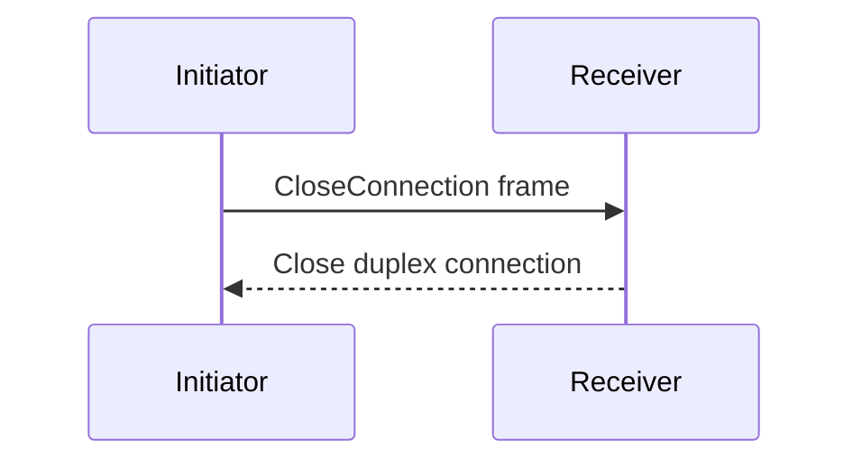

A shutdown is a graceful closure of a connection. Each side wants to maximize the chances that outstanding requests
complete successfully.

## Shutdown steps

Either side of an ice connection, client or server, can shut down this connection. The side that initiates the shutdown
(the initiator) proceeds as follows:

1. The initiator stops sending requests to the peer, and stops accepting requests from the peer.

2. The initiator waits for its outstanding invocations and dispatches to complete.

3. The initiator stops sending [heartbeats](connection-establishment#validateconnection-frame) to the peer.

4. The initiator sends a [CloseConnection](#closeconnection-frame) frame to the peer.

5. The initiator waits for the peer to close the duplex connection or to send a `CloseConnection` frame, then closes
   the duplex connection.

The side that receives the `CloseConnection` frame (the receiver) closes the duplex connection as soon as it has stopped
writing; it does not wait for its dispatches to complete.

Because of steps 1 and 2, the initiator did not dispatch the requests of the receiver's outstanding invocations: the
receiver can safely send these requests again over another connection.

The following sequence diagram shows the interactions between the initiator and the receiver:

## CloseConnection frame

The `CloseConnection` frame is an ice protocol frame with type `CloseConnection`. Its body is empty. A client or server
must not send any additional frame after sending a `CloseConnection` frame.
